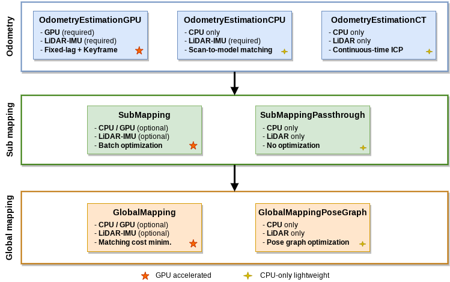

## Introduction

**GLIM** is a versatile and extensible range-based 3D mapping framework.

- ***Accuracy:*** GLIM is based on direct multi-scan registration error minimization on factor graphs that enables to accurately retain the consistency of mapping results. GPU acceleration is supported to maximize the mapping speed and quality.
- ***Easy-to-use:*** GLIM offers an interactive map correction interface that enables the user to manually correct mapping failures and easily refine mapping results.
- ***Versatility:*** As we eliminated sensor-specific processes, GLIM can be applied to any kind of range sensors including:
    - Spinning-type LiDAR (e.g., Velodyne HDL32e and Ouster OS1-32)
    - Non-repetitive scan LiDAR (e.g., Livox Avia and MID360)
    - Solid-state LiDAR (e.g., Intel Realsense L515)
    - RGB-D camera (e.g., Microsoft Azure Kinect)
- ***Extensibility:*** GLIM provides the global callback slot mechanism that allows to access the internal states of the mapping process and insert additional constraints to the factor graph. We also release [glim_ext](https://github.com/koide3/glim_ext) that offers example implementations of several extension functions (e.g., explicit loop detection, LiDAR-Visual-Inertial odometry estimation).

**Documentation: [https://koide3.github.io/glim/](https://koide3.github.io/glim/)**
**Docker hub:** [koide3/glim_ros2](https://hub.docker.com/repository/docker/koide3/glim_ros2/tags)
**Related packages:** [gtsam_points](https://github.com/koide3/gtsam_points), [glim](https://github.com/koide3/glim), ~~[glim_ros1](https://github.com/koide3/glim_ros1),~~ [glim_ros2](https://github.com/koide3/glim_ros2), [glim_ext](https://github.com/koide3/glim_ext)

Tested on Ubuntu 22.04 / 24.04 with CUDA 12.2 / 12.6 / 13.1, and NVIDIA Jetson Orin (Jetpack 6.1).

If you find this package useful for your project, please consider leaving a comment [here](https://github.com/koide3/glim/issues/19). It would help the author receive recognition in his organization and keep working on this project.

[](https://github.com/koide3/glim/actions/workflows/build.yml)
[](https://github.com/koide3/glim_ros2/actions/workflows/build.yml)
[](https://github.com/koide3/glim_ext/actions/workflows/build.yml)

## Updates

- 2026/01/24 : v1.2.0 released. Added Support for both **GTSAM 4.2a9** and **GTSAM 4.3a0**, and **CUDA 13.1**. Added intensity visualization support.
- 2025/06/15 : The base GTSAM version has been changed. Make sure you have rebuilt and installed **GTSAM 4.3a0** and **gtsam_points 1.2.0**.

## Milla fork: GPU memory offloading for long-term mapping

[中文版](README_zh.md)

With `VGICP_GPU`, every submap keeps its point cloud and voxelmaps on the GPU (~7 MB per submap with the default Milla settings), so the GPU memory grows linearly with the mapping duration (~6 GB for a 20 min drive). The global mapping module can offload the GPU data of distant submaps to CPU memory, and reload them when they get close enough to become loop candidates.

### Requirement

The offloading relies on a fix in **gtsam_points** (branch `feature/dynamicLoardGP`, `IntegratedVGICPDerivatives::touch_points()`): without it, factors that share an offloaded voxelmap/point cloud reload it concurrently on different CUDA streams, which results in wrong Hessians or `cudaErrorIllegalAddress`. Rebuild and install gtsam_points from that branch before enabling the feature:

```bash
cd gtsam_points && rm -rf build && mkdir build && cd build
cmake .. -DCMAKE_BUILD_TYPE=Release -DBUILD_WITH_CUDA=ON -DCMAKE_CUDA_ARCHITECTURES=89
make -j$(nproc) && sudo make install && sudo ldconfig
```

### Configuration (`config/config_global_mapping_gpu.json`)

| Parameter | Default | Description |
|---|---|---|
| `enable_gpu_offload` | `true` | Enable the offloading (only with `registration_error_factor_type: "VGICP_GPU"`) |
| `gpu_offload_keep_recent_submaps` | `80` | Latest submaps always kept on the GPU (they are still being optimized). ~1.5 s per submap |
| `gpu_offload_prefetch_margin` | `50.0` | Submaps within `max_implicit_loop_distance + margin` [m] are reloaded in advance for loop detection |
| `gpu_offload_distance` | `250.0` | Submaps farther than this [m] are offloaded. The gap with the prefetch distance acts as hysteresis |
| `gpu_offload_max_resident_mb` | `4000.0` | Max GPU memory [MB] for submap data. Beyond it, least recently used submaps are also offloaded (`<= 0`: disabled) |
| `gpu_offload_freeze_relinearization` | `true` | Offloaded submaps are not relinearized (iSAM2 reuses their cached linear factors). Keep it `true`, otherwise offloaded submaps are reloaded at every relinearization |

The defaults in the code keep the upstream behavior. The Milla config enables the offloading.

### Monitoring

Every 100 submaps, the global mapping logs:

```
GPU offload: 120/1500 submaps on GPU (850 MB), device memory usage 5200/12282 MB (incl. CUDA memory pool)
```

Freed GPU memory stays in the CUDA memory pool and is reused by the next allocations. `nvidia-smi` and `memory_monitor` therefore stop growing but do **not** go down after offloading. Use the "submaps on GPU" value to check the offloading.

### Limitations

- **Full relinearization:** when a large loop closure affects more than 65% of the variables, iSAM2 relinearizes all factors, and all submaps are reloaded at once. The peak memory is then the same as without offloading. The same happens when iSAM2 is rebuilt after an indeterminant system exception.
- **`find_overlapping_submaps`** (manual button in the viewer) reloads every submap pair within `max_implicit_loop_distance` without offloading them in between.
- **Offline viewer:** `GlobalMapping::load()` uploads all submaps to the GPU and does not offload them. To only export points from a long map, set `registration_error_factor_type` to `"VGICP"` in `<dump>/config/config_global_mapping_gpu.json` and answer "No" to "Do optimization?" (`Export Points` only uses CPU data).
- Not compatible with modules that evaluate `IntegratedVGICPFactorGPU` factors synchronously (`factor->error()` / `factor->linearize()` without the linearization hook), e.g., `global_mapping_pose_graph` and the scan context loop detector of glim_ext: offloaded data are only reloaded in the batch linearization path.

## Dependencies
### Mandatory
- [Eigen](https://eigen.tuxfamily.org/index.php)
- [nanoflann](https://github.com/jlblancoc/nanoflann)
- [GTSAM](https://github.com/borglab/gtsam)
- [gtsam_points](https://github.com/koide3/gtsam_points)

### Optional
- [CUDA](https://developer.nvidia.com/cuda-toolkit)
- [OpenCV](https://opencv.org/)
- [OpenMP](https://www.openmp.org/)
- [ROS/ROS2](https://www.ros.org/)
- [Iridescence](https://github.com/koide3/iridescence)

## Gallery

See more at [Video Gallery](https://github.com/koide3/glim/wiki/Video-Gallery).

| Mapping with various range sensors | Outdoor driving test with Livox MID360 |
|---|---|
|[](https://www.youtube.com/watch?v=_fwK4awbW18)|[](https://www.youtube.com/watch?v=CIfRqeV0irE)|

| Manual loop closing | Merging multiple mapping sessions |
|---|---|
|||

| Object segmentation and removal |  |
|---|---|
|| |

## Estimation modules

GLIM provides several estimation modules to cover use scenarios, from robust and accurate mapping with a GPU to lightweight real-time mapping with a low-specification PC like Raspberry Pi.



## Thirdparty works using GLIM

If you are willing to add your work here, feel free to let me know in [this thread](https://github.com/koide3/glim/issues/19) :)

- [kamibukuro5656/MapCleaner_Unofficial](https://github.com/kamibukuro5656/MapCleaner_Unofficial)

## License

This package is released under the MIT license. For commercial support, please contact ```k.koide@aist.go.jp```.

If you find this package useful for your project, please consider leaving a comment [here](https://github.com/koide3/glim/issues/19). It would help the author receive recognition in his organization and keep working on this project. Please also cite the following paper if you use this package in your academic work.

## Related work

Koide et al., "GLIM: 3D Range-Inertial Localization and Mapping with GPU-Accelerated Scan Matching Factors", Robotics and Autonomous Systems, 2024, [[DOI]](https://doi.org/10.1016/j.robot.2024.104750) [[Arxiv]](https://arxiv.org/abs/2407.10344)

The GLIM framework involves ideas expanded from the following papers:
- (LiDAR-IMU odometry and mapping) "Globally Consistent and Tightly Coupled 3D LiDAR Inertial Mapping", ICRA2022 [[DOI]](https://doi.org/10.1109/ICRA46639.2022.9812385)
- (Global registration error minimization) "Globally Consistent 3D LiDAR Mapping with GPU-accelerated GICP Matching Cost Factors", IEEE RA-L, 2021, [[DOI]](https://doi.org/10.1109/LRA.2021.3113043)
- (GPU-accelerated scan matching) "Voxelized GICP for Fast and Accurate 3D Point Cloud Registration", ICRA2021, [[DOI]](https://doi.org/10.1109/ICRA48506.2021.9560835)

## Contact
[Kenji Koide](https://staff.aist.go.jp/k.koide/), k.koide@aist.go.jp<br>
National Institute of Advanced Industrial Science and Technology (AIST), Japan

